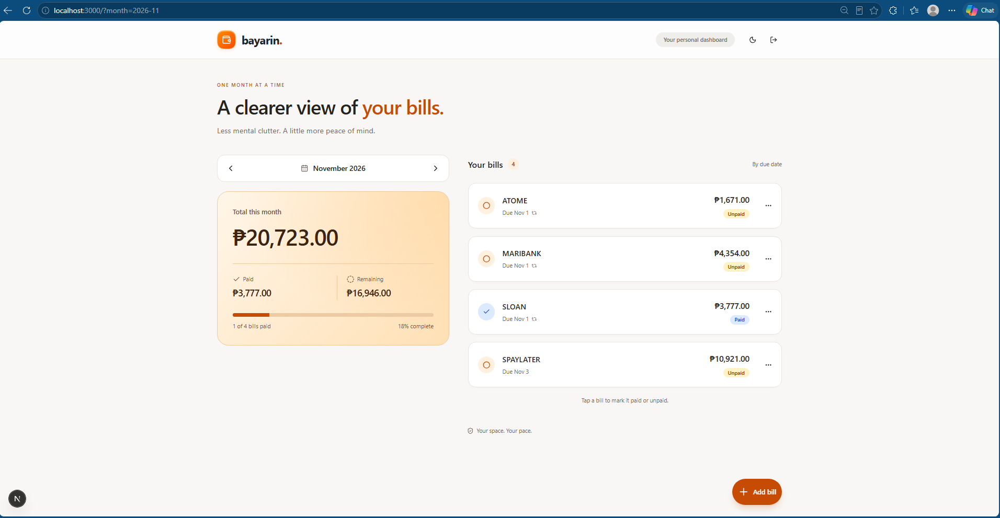
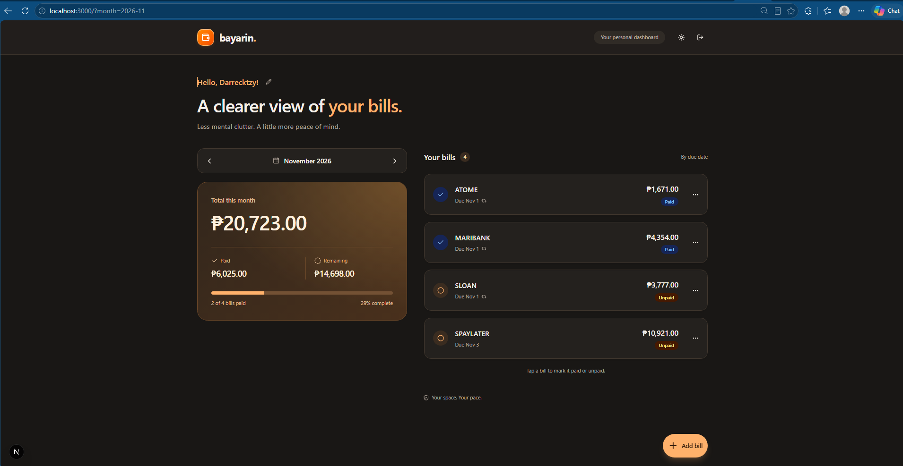

<p align="center"></p>

# Bayarin

**Monthly bills, a little more under control.**

A personal monthly bills and debt tracker with recurring bills, payment progress, an editable greeting, and light/dark themes. Built with **Next.js App Router, TypeScript, Tailwind CSS, shadcn/ui, Supabase Auth/Postgres**, and `@supabase/ssr`.

[Install locally](#run-locally) · [Screenshots](#screenshots) · [Deployment guide](DEPLOY.md) · [Verification](CHECKS.md)

## Features

- Browse bills by month, sorted by due date.
- Track Total, Paid, Remaining, and amount-weighted payment progress in Philippine pesos.
- Mark a bill Paid/Unpaid with a click; payment status stays independent for each month.
- Create, edit, and delete recurring or one-time bills.
- See overdue bills in red, using the Manila calendar date.
- Personalize the greeting with a name saved to your Supabase account.
- Use a wide desktop dashboard or a stacked mobile layout, with light and dark themes.
- Sign in with your sole email/password account; database RLS enforces ownership.

## Screenshots

### Light mode



### Dark mode



The dark-mode capture shows the current editable greeting and pencil button. The light-mode image illustrates the earlier dashboard layout.

## Run locally

Requires **Node.js 24.x**, npm, Git, and a Supabase project. This is a single-account personal app with public signups disabled.

### 1. Clone and install

```sh
git clone https://github.com/darreck0/bayarin.git
cd bayarin
npm ci
```

The source repository is public. Bill data still requires Supabase authentication and belongs to the project configured in your local environment.

### 2. Set up Supabase

For a new Supabase project:

1. Create your project, then manually create **one confirmed email/password user** in Authentication.
2. Disable **Allow new users to sign up**; keep email/password enabled and anonymous/social sign-in disabled.
3. Run [`supabase/migrations/202610310001_bayarin.sql`](supabase/migrations/202610310001_bayarin.sql) once in SQL Editor.
4. Run [`supabase/tests/verify.sql`](supabase/tests/verify.sql) to check the seed, RLS, and anonymous access denial.

**Already using a configured Bayarin Supabase project?** Reuse its URL and key. Do not rerun the migration. See [DEPLOY.md](DEPLOY.md) for the full setup walkthrough.

### 3. Configure the environment

Create `.env.local` from the template using your terminal:

**Windows Command Prompt (CMD)**

```cmd
if not exist .env.local copy .env.example .env.local
notepad .env.local
```

<details>
<summary>PowerShell or macOS/Linux</summary>

PowerShell:

```powershell
Copy-Item .env.example .env.local -NoClobber
notepad .env.local
```

macOS/Linux:

```sh
cp -n .env.example .env.local
```

</details>

In Supabase, open your project's **Connect** dialog or **Settings → API Keys**. Put the project URL and **publishable** API key in `.env.local`:

```dotenv
NEXT_PUBLIC_SUPABASE_URL=https://your-project.supabase.co
NEXT_PUBLIC_SUPABASE_PUBLISHABLE_KEY=your-supabase-publishable-key
```

### 4. Start the app

```sh
npm run dev
```

Open [localhost:3000](http://localhost:3000). Without configuration, the login screen explains setup and disables sign-in. Restart the server after changing environment values. Never use a service-role/secret key here. `.env.local` is ignored by Git; `.env.example` is included.

Sign in using the account you created in Supabase. Visit `http://localhost:3000/?month=2026-11` to see the November 2026 seed bills. Click **Add your name** or the pencil icon to personalize your greeting.

GitHub stores this app's source code. Bill records and payment statuses are saved to the Supabase project you configured. For an online URL that works while your laptop is off, follow the [Vercel deployment guide](DEPLOY.md).

## Verify before deploying

Run each command individually and fix failures before advancing:

```powershell
npm test
npm run typecheck
npm run lint
npm run build
```

After a successful build, `npm run start` runs the production server. Stop the dev server first if using the same port. See [CHECKS.md](CHECKS.md) for completed checks and remaining live verification.

## Behavior

- **Greeting:** click the pencil beside “Hello, Name!” to change your name, then **Save name**. It is saved to your Supabase account's `display_name` metadata and remains after login/reload. Without a profile name, the app shows “Hello!” and **Add your name**, with no email fallback.
- **Months:** `/?month=YYYY-MM`; defaults to the current Manila month. Invalid parameters redirect to the default view. Navigation supports years 1000–9999.
- **Recurrence:** bills appear from `start_month` onward without cron jobs or monthly copies. One-time bills appear only in their start month. New bills start in the selected month.
- **Payments:** a missing row means unpaid. Each toggle upserts explicit paid/unpaid status for one `(bill_id, month)`. Marking paid sets `paid_at`; unpaid clears it. Each month's status is independent.
- **Overdue:** unpaid with a due date before today in `Asia/Manila`. Due today stays unpaid. Days 29–31 clamp to the last valid day. The open app checks for date rollover and updates after returning to the tab.
- **Money:** `numeric(12,2)` in Postgres; integer centavos for validation and totals. Progress measures amount paid / total. Empty months show zero totals and 0%.
- **Edits:** name, amount, due day, and recurrence apply across applicable months. Start month stays fixed. Turning recurrence off leaves the bill only in its original start month.
- **Delete:** confirmation removes every occurrence and cascades to all payment history. Historical values are not snapshotted.
- **Access:** protected reads/actions verify Auth. RLS checks ownership for reads and writes on both tables. A composite foreign key prevents a payment from referencing another owner's bill. Proxy refreshes cookies and sets private/no-store cache headers.
- **Layout:** side-by-side monthly summary and bills on laptop/desktop (1024px and up); stacked on smaller screens.
- **Theme:** warm white/cream with orange accents, starting in light mode. The toggle persists light/dark preference in this browser. This redesign resets the previous green theme preference once. Paid badges are blue, unpaid amber, and overdue red.

Debts are monthly obligations in this version. Interest, balances, installments, partial payments, reminders, and public registration are outside scope.

## Seed

| Bill | Amount | Due day | Start | Recurring |
| --- | ---: | ---: | --- | --- |
| ATOME | ₱1,671.00 | 1 | November 2026 | Yes |
| MARIBANK | ₱4,354.00 | 1 | November 2026 | Yes |
| SLOAN | ₱3,777.00 | 1 | November 2026 | Yes |
| **Total** | **₱9,802.00** | | | |

November starts unpaid. After signing in, visit `/?month=2026-11`. The migration requires exactly one existing Auth user and resolves its ID automatically, without embedding a password or personal email.

## Folder structure

```text
bayarin/
├── src/
│   ├── app/
│   │   ├── login/            # Login page; sign-in/sign-out actions
│   │   ├── actions.ts        # Bill CRUD and payment actions
│   │   ├── profile-actions.ts # Save the account display name
│   │   ├── page.tsx          # Protected month dashboard
│   │   ├── layout.tsx        # Metadata and theme provider
│   │   ├── loading.tsx       # Loading skeleton
│   │   ├── error.tsx         # Recoverable error page
│   │   ├── globals.css       # Tailwind and light/dark tokens
│   │   └── icon.svg
│   ├── components/
│   │   ├── ui/              # Generated shadcn/ui components
│   │   ├── dashboard.tsx
│   │   ├── greeting.tsx       # Editable name and greeting
│   │   ├── bill-row.tsx
│   │   ├── bill-form.tsx
│   │   ├── delete-bill-dialog.tsx
│   │   ├── summary-card.tsx
│   │   ├── month-switcher.tsx
│   │   └── ...              # Header, brand, login, theme
│   ├── lib/
│   │   ├── supabase/        # Cookie-aware server/browser clients
│   │   ├── database.types.ts
│   │   ├── load-bills.ts
│   │   ├── bills.ts         # Recurrence, status, totals, sorting
│   │   ├── calendar.ts
│   │   ├── money.ts
│   │   └── ...              # Validation and small shared helpers
│   └── proxy.ts             # Auth cookie refresh and early redirects
├── supabase/
│   ├── migrations/202610310001_bayarin.sql
│   └── tests/verify.sql
├── tests/                   # Database, auth, actions, logic, render
├── .env.example
├── components.json
├── package.json
├── package-lock.json
├── vitest.config.ts
├── CHECKS.md
├── DEPLOY.md
└── README.md
```

The project `.npmrc` clears an inherited global CLI-only `allow-scripts` setting that otherwise breaks npm project installs. Your global npm configuration is unchanged.
